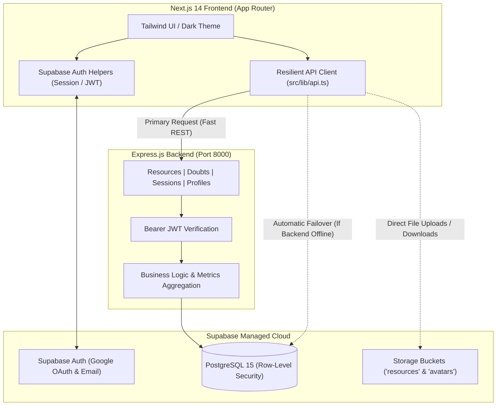
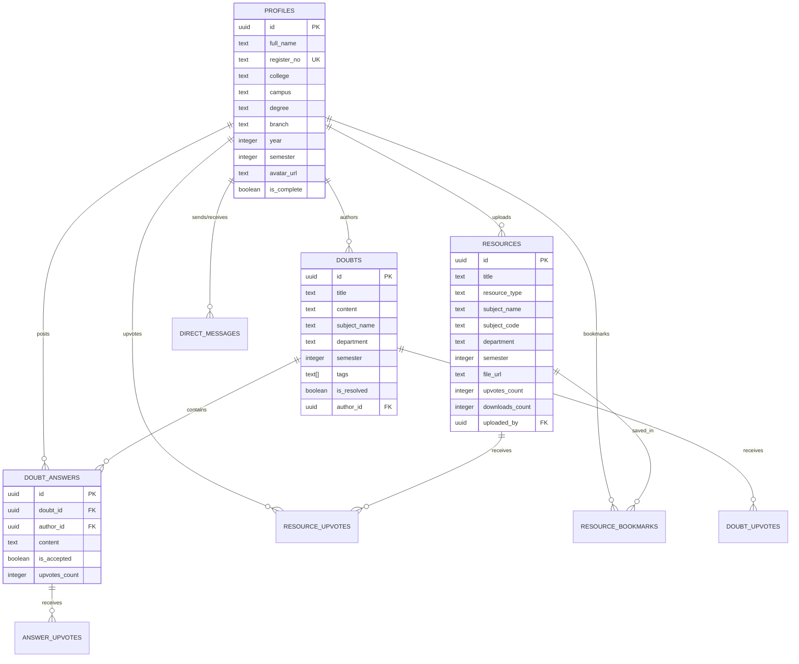

# 🎓 EduLink — Academic Resource Hub & Peer Collaboration Platform

<div align="center">

  [](https://edulink.vercel.app/)
  [](https://nextjs.org/)
  [](https://expressjs.com/)
  [](https://supabase.com/)
  [](https://www.typescriptlang.org/)
  [](https://tailwindcss.com/)

  <p align="center">
    <strong>The StuDocu + Stack Overflow hybrid engineered specifically for SRM Institute of Science and Technology (KTR Campus).</strong>
  </p>

  <p align="center">
    <a href="#-features-at-a-glance">Features</a> •
    <a href="#-quick-start">Quick Start</a> •
    <a href="#-system-architecture">Architecture</a> •
    <a href="#-database-schema--rls">Database & RLS</a> •
    <a href="#-hybrid-fallback-engine">Hybrid Engine</a> •
    <a href="#-api-endpoints">API Reference</a> •
    <a href="#-environment-variables">Env Config</a> •
    <a href="#-deployment">Deployment</a>
  </p>

</div>

---

## 💡 Overview

**EduLink** solves the fragmented academic resource problem at SRMIST KTR. Instead of scattered Google Drives, WhatsApp group links, and lost exam papers, EduLink provides a unified campus ecosystem:
- **Curated Academic Library**: Unit notes, previous year questions (PYQs), lab manuals, reference books, and syllabi indexed by branch, year, semester, and course code.
- **Peer Doubts Forum**: Subject-wise discussion board with code formatting, verified answers, and reputation upvotes.
- **Virtual Study Sessions**: Synchronous study rooms with real-time chat and FullCalendar schedules.
- **1-on-1 Student Chat**: Peer-to-peer networking between seniors and juniors across engineering streams.
- **Campus-Verified Profiles**: Secure registration tracking SRM register numbers (`RA...`) with client-side image compression (<50 KB) for avatars.

---

## ⚡ Features at a Glance

| Module | Description | Key Tech |
|---|---|---|
| 📚 **Academic Library** | Search, filter, preview, bookmark, and download notes and PYQs by SRM branch, semester, and subject code. | Next.js App Router, Supabase Storage |
| 💬 **Doubts Forum** | Ask academic questions, upvote quality answers, and mark verified solutions. | Supabase PostgreSQL, RLS Policies |
| 📅 **Study Sessions** | Plan virtual study groups with live participant rooms, chat, and calendar integration. | FullCalendar, Supabase Realtime |
| 💬 **Direct Messaging** | Instant 1-on-1 student conversations for notes exchange and peer tutoring. | Supabase RLS Messaging |
| 🛡️ **Verified Identity** | SRMIST student profiles verified by register number, degree, and semester. | Client Canvas Compressor (<50KB), Supabase Auth |
| 🔄 **Zero-Downtime Resilience**| Transparently falls back to direct Supabase database calls if the Express backend is sleeping or blocked. | Dual-Mode Fetch Engine (`src/lib/api.ts`) |

---

## 🚀 Quick Start

Run both the frontend and backend with a single command.

### 1. Prerequisites
- **Node.js**: `v18.x` or higher
- **npm** or **pnpm**
- A free **Supabase** project ([supabase.com](https://supabase.com))

### 2. Clone & Install
```bash
# Clone the repository
git clone https://github.com/Hitesh-09/Edulink.git
cd Edulink

# Install root, backend, and frontend dependencies
npm install
npm --prefix edulink-backend install
npm --prefix edulink-frontend install
```

### 3. Database Setup (Supabase)
1. Go to your **Supabase Dashboard** > **SQL Editor**.
2. Open [`edulink-backend/schema.sql`](edulink-backend/schema.sql) and run the entire script.
3. This creates all tables, triggers, indexes, Row Level Security (RLS) policies, and storage buckets (`resources`, `avatars`).

### 4. Configure Environment Variables

**Frontend** (`edulink-frontend/.env.local`):
```env
NEXT_PUBLIC_SUPABASE_URL="https://your-project.supabase.co"
NEXT_PUBLIC_SUPABASE_ANON_KEY="your-anon-key"
NEXT_PUBLIC_API_URL="http://localhost:8000"
```

**Backend** (`edulink-backend/.env`):
```env
SUPABASE_URL="https://your-project.supabase.co"
SUPABASE_SERVICE_ROLE_KEY="your-service-role-key"
PORT=8000
NODE_ENV=development
FRONTEND_URL="http://localhost:3000"
```

### 5. Start Development
From the root directory, run:
```bash
npm run dev
```

This concurrently starts:
- 🌐 **Frontend**: [http://localhost:3000](http://localhost:3000)
- ⚙️ **Backend API**: [http://localhost:8000](http://localhost:8000)

---

## 🧭 System Architecture

EduLink operates on a resilient dual-layer architecture:



<details>
<summary>📂 <strong>Click to expand full repository directory tree</strong></summary>

```text
Edulink/
├── dev.js                          # Concurrent runner script for backend + frontend
├── package.json                    # Root monorepo workspace scripts
├── LICENSE                         # MIT License
├── edulink-backend/                # Express + TypeScript REST API
│   ├── schema.sql                  # Complete PostgreSQL schema, triggers & RLS policies
│   ├── package.json                # Backend dependencies
│   ├── tsconfig.json               # Backend TypeScript configuration
│   └── src/
│       ├── index.ts                # Express app entrypoint & middleware setup
│       ├── controllers/            # Request handlers (resources, doubts, sessions, etc.)
│       ├── routes/                 # Express route definitions
│       ├── services/               # Service layer interfacing with Supabase admin client
│       ├── middleware/             # JWT auth validation & global error handler
│       └── types/                  # Shared backend TypeScript definitions
└── edulink-frontend/               # Next.js 14 (App Router) client
    ├── package.json                # Frontend dependencies
    ├── tailwind.config.js          # Dark theme colors (#141314, #FF553E accent)
    └── src/
        ├── app/                    # Next.js pages & layouts
        │   ├── page.tsx            # Cinematic landing page
        │   ├── auth/               # Google OAuth & personal email login/signup
        │   ├── dashboard/          # Student home feed & daily metrics
        │   ├── resources/          # StuDocu-style notes & PYQ library
        │   ├── doubts/             # Community Q&A forum
        │   ├── sessions/           # Virtual study rooms & calendar
        │   ├── messages/           # 1-on-1 student direct chat
        │   ├── profile/            # Profile settings & avatar image compressor
        │   └── profile-setup/      # SRM onboarding & register number verification
        ├── components/             # Reusable UI cards, modals, sidebar & navigation
        └── lib/
            ├── api.ts              # Resilient API layer with direct Supabase fallback
            └── supabase.ts         # Supabase client initializers
```

</details>

---

## 🗄️ Database Schema & RLS

EduLink uses strict PostgreSQL schemas enforced by **Supabase Row Level Security (RLS)** to protect user academic data.



### Key Security Policies (RLS)
- **Profiles**: Public read for authenticated students; updates and inserts restricted strictly to the user's own `auth.uid()`.
- **Resources**: Anyone authenticated can query resources; only resource authors can modify or delete their files.
- **Doubts & Answers**: Open access for SRM students; only authors can edit; accepted answers can only be toggled by the original question poster.
- **Direct Messaging**: Messages are strictly readable only by the `sender_id` or `receiver_id`.

---

## 🛡️ Resilient Dual-Mode Engine

When hosted on serverless platforms like Vercel, client requests often face mixed-content blocks or sleeping microservices if an external Express server isn't actively deployed.

EduLink implements an **Automated Direct-Fallback Pattern** in [`edulink-frontend/src/lib/api.ts`](edulink-frontend/src/lib/api.ts):
1. **Primary Route**: Requests attempt to call the Express API at `NEXT_PUBLIC_API_URL`.
2. **Offline Detection**: If the API is unreachable, times out, or running in a serverless environment where localhost is blocked, it automatically switches to direct client-side Supabase RPC/queries.
3. **No User Impact**: Resource fetching, doubt submissions, answer accepting, bookmarks, and upvotes continue functioning smoothly with zero downtime.

---

## 📡 API Reference

When running the Express backend, the following endpoints are available:

### Academic Resources
- `GET /api/resources` — List & filter resources (`department`, `semester`, `type`, `subject`)
- `POST /api/resources` — Upload note or PYQ metadata
- `POST /api/resources/:id/upvote` — Upvote / un-upvote a resource
- `POST /api/resources/:id/bookmark` — Bookmark / un-bookmark a resource
- `POST /api/resources/:id/download` — Increment resource download count

### Community Doubts
- `GET /api/doubts` — List questions with filters (`department`, `semester`, `resolved`, `search`)
- `GET /api/doubts/:id` — Get question details and all submitted answers
- `POST /api/doubts` — Post a new doubt
- `POST /api/doubts/:id/answers` — Post an answer to a doubt
- `POST /api/doubts/:id/upvote` — Upvote a question
- `POST /api/doubts/answers/:answerId/accept` — Accept verified solution

### Study Sessions & Connections
- `GET /api/sessions` — List upcoming virtual study sessions
- `POST /api/sessions` — Schedule a new study room
- `GET /api/connections` — List student peer connections and pending invites

---

## 🔧 Environment Variables

### Frontend (`edulink-frontend/.env.local`)
| Variable | Description | Example |
|---|---|---|
| `NEXT_PUBLIC_SUPABASE_URL` | Your Supabase project URL | `https://xxxx.supabase.co` |
| `NEXT_PUBLIC_SUPABASE_ANON_KEY` | Supabase anonymous public API key | `eyJhbGci...` |
| `NEXT_PUBLIC_API_URL` | Express backend URL (defaults to localhost) | `http://localhost:8000` |

### Backend (`edulink-backend/.env`)
| Variable | Description | Example |
|---|---|---|
| `SUPABASE_URL` | Your Supabase project URL | `https://xxxx.supabase.co` |
| `SUPABASE_SERVICE_ROLE_KEY` | Supabase service-role admin key | `eyJhbGci...` |
| `PORT` | Port for the Express server | `8000` |
| `NODE_ENV` | Runtime environment | `development` or `production` |
| `FRONTEND_URL` | Allowed origin for CORS | `https://edulink.vercel.app` |

---

## 📦 Available Scripts

Run from the root directory:

| Script | Command | Action |
|---|---|---|
| **dev** | `npm run dev` | Runs both backend and frontend concurrently |
| **dev:frontend** | `npm run dev:frontend` | Runs only Next.js frontend (`localhost:3000`) |
| **dev:backend** | `npm run dev:backend` | Runs only Express backend (`localhost:8000`) |
| **build:frontend**| `npm run build:frontend`| Compiles Next.js production build |
| **build:backend** | `npm run build:backend` | Compiles TypeScript backend to `dist/` |
| **build** | `npm run build` | Builds both backend and frontend |

---

## 🚢 Deployment

### Frontend (Vercel)
1. Push your repository to GitHub.
2. Import the project into [Vercel](https://vercel.com).
3. Set the **Root Directory** to `edulink-frontend`.
4. Configure the environment variables:
   - `NEXT_PUBLIC_SUPABASE_URL`
   - `NEXT_PUBLIC_SUPABASE_ANON_KEY`
   - `NEXT_PUBLIC_API_URL` (optional: leave pointing to your deployed backend or blank to utilize Supabase direct mode)
5. Deploy!

### Backend (Render / Railway / AWS / VPS)
1. Deploy `edulink-backend` using Docker or Node runtime.
2. Build command: `npm run build`
3. Start command: `npm start`
4. Supply `SUPABASE_URL`, `SUPABASE_SERVICE_ROLE_KEY`, and `FRONTEND_URL`.

---

## 👥 Contributors & SRMIST Community

Crafted with ❤️ by **[Hitesh Shimpi](https://github.com/Hitesh-09)** for the students and faculty of **SRM Institute of Science and Technology, Kattankulathur**.

- **Website**: [edulink.vercel.app](https://edulink.vercel.app/)
- **Author Portfolio**: [itshitesh.vercel.app](https://itshitesh.vercel.app/)
- **Contact**: `hiteishshimpi@gmail.com`

---

## 📄 License

This project is licensed under the [MIT License](LICENSE).
